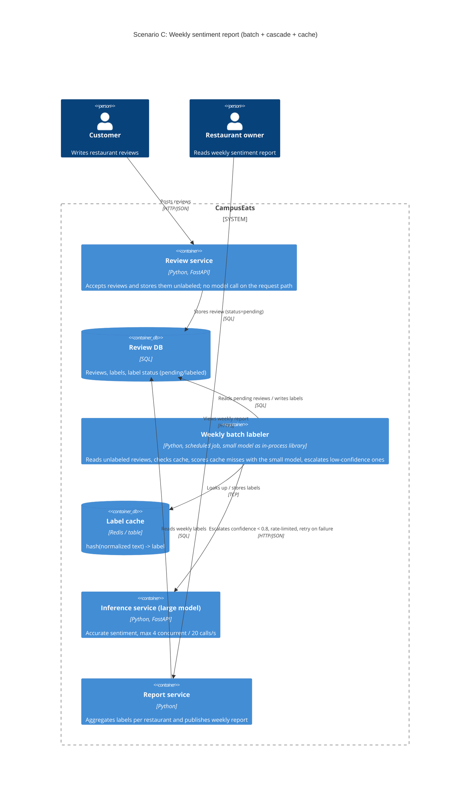

# Task 4: Deployment topologies and trade-offs

**Name / ชื่อ:**

**Student ID / รหัสนิสิต:**

This is **individual work**: each student completes and submits their own copy, in their own fork.

_งานนี้เป็น**งานเดี่ยว** นิสิตแต่ละคนทำและส่งงานของตัวเอง ใน fork ของตัวเอง_

**Scenario (A, B or C) / Scenario ที่เลือก:**

Choose **one** scenario below. If the last digit of your student ID is odd, take A or B; if it is even, take B or C. Use your measurements from Tutorial 6 as evidence: cite run names from `results/runs.csv`. Answer in Thai or English.

เลือก scenario **หนึ่ง** ข้อด้านล่าง ถ้าเลขตัวสุดท้ายของรหัสนิสิตเป็นเลขคี่ ให้เลือก A หรือ B ถ้าเป็นเลขคู่ ให้เลือก B หรือ C ใช้ผลการวัดจาก tutorial ที่ทำไปเป็นข้อมูลอ้างอิง โดยอ้างชื่อ run จาก `results/runs.csv` จะตอบเป็นภาษาไทยหรือภาษาอังกฤษก็ได้

Facts that hold in every scenario / ข้อเท็จจริงที่ใช้กับทุก scenario:

- The large model serves at most **20 calls per second** (4 calls at once × about 200 ms each), and every call costs money.

  _large model รับได้สูงสุด **20 calls ต่อวินาที** (พร้อมกัน 4 calls × ประมาณ 200 ms ต่อ call) และทุก call มีค่าใช้จ่าย_

- The small model is fast and cheap enough to run anywhere, including inside the review service or on a kiosk, but it is much less accurate on its own.

  _small model เร็วและถูกพอที่จะรันที่ไหนก็ได้ รวมถึงภายใน review service หรือบน kiosk แต่ถ้าใช้ตัวเดียวจะแม่นน้อยกว่ามาก_

## Scenarios

**A. Owner alerts.** When a customer posts a negative review, the restaurant owner gets a push notification within **2 seconds**. At the lunch peak, CampusEats receives **40 reviews per second**. A missed alert is acceptable, but a wrong alert (for example, "your customer is unhappy" when they are happy) makes owners stop trusting alerts and, in the end, ignore them.

_เมื่อลูกค้าโพสต์รีวิวเชิงลบ เจ้าของร้านจะต้องได้รับ push notification ภายใน **2 วินาที** เวลาช่วงพีคตอนเที่ยง CampusEats ได้รับรีวิวจำนวน **40 รายการต่อวินาที** การพลาด alert ไปบ้างนั้นยอมรับได้ แต่ alert ที่ผิด (เช่น "ลูกค้าไม่พอใจ" ทั้งที่จริงๆ แล้วพอใจ) จะทำให้เจ้าของร้านไม่เชื่อถือและเลิกสนใจ alert ในที่สุด_

**B. Canteen kiosk.** A tablet in each canteen lets students leave a review on the spot. However, the canteen Wi-Fi is poor: the tablets lose their connection several times a day, for minutes at a time. The system must accept every review, even while a tablet is offline. Restaurant owners need the labels **by the end of the day**.

\*มี tablet ในแต่ละโรงอาหารให้นิสิตรีวิวได้ทันที อย่างไรก็ดี การเชื่อมต่อ Wi-Fi ในโรงอาหารไม่ดี ทำให้ tablet หลุดการเชื่อมต่อวันละหลายครั้ง ครั้งละหลายนาที ระบบจะต้องรับรีวิวได้ทุกรายการแม้ขณะที่กำลัง offline อยู่ และเจ้าของร้านต้องการ label **ภายในสิ้นวัน\***

**C. Weekly report.** Restaurant owners want a weekly sentiment report. Nothing in producing this report has to be real-time. **Accuracy matters most** and **cost must be minimal**.

\*เจ้าของร้านต้องการรายงาน sentiment รายสัปดาห์ ไม่มีอะไรที่จะต้องทำแบบ real-time ในการออกรายงานนี้ ความแม่นยำ **(accuracy) สำคัญที่สุด** และ **ค่าใช้จ่ายต้องน้อยที่สุด\***

## Topologies and patterns to choose from / Topology และ pattern ที่เลือกใช้ได้

|     | Topology                        | Where the model runs / โมเดลรันที่ไหน                                                                                                           |
| --- | ------------------------------- | ----------------------------------------------------------------------------------------------------------------------------------------------- |
| T1  | Model as a service, synchronous | Inference service, called for each review (today's baseline) _inference service ถูกเรียกทุกรีวิว (baseline ของวันนี้)_                       |
| T2  | Model as a library              | Inside the review service, or on the device _ภายใน review service หรือบนอุปกรณ์_                                                             |
| T3  | Hybrid                          | Small model locally, large model as a remote service _small model รันในเครื่อง large model เป็น remote service_                              |
| T4  | Asynchronous / batch            | Reviews are queued (broker, W10) or stored, and scored later in bulk _รีวิวถูกเข้าคิว (broker, W10) หรือเก็บไว้ แล้วติด label ทีหลังเป็นชุด_ |

Combine one topology with any of the patterns from Tutorial 6: **fallback**, **cascade** and **cache**.

\*เลือก topology หนึ่งแบบ แล้วผสมกับ pattern จาก Tutorial 6 ได้ตามต้องการ: **fallback**, **cascade** และ **cache\***

## 1. Quality requirements

The three most important quality requirements for your scenario, each with a number where possible.

_quality requirements ที่สำคัญที่สุด 3 ข้อของ scenario ที่เลือก ระบุตัวเลขเมื่อทำได้_

| #   | Quality         | Requirement                                                                                                                                             |
| --- | --------------- | ------------------------------------------------------------------------------------------------------------------------------------------------------- |
| 1   | Accuracy        | accuracy ของ label ในรายงานต้องไม่ต่ำกว่า 93.5%                                                                                                         |
| 2   | Cost efficiency | จำนวน call ไป large model มีเป้า <= 40% ของรีวิว (ค่าที่วัดได้จาก t4-0.8-cache) และเพดานที่ยอมรับได้ ≤ 50% โดย accuracy ต้องไม่ต่ำกว่าข้อ 1             |
| 3   | Batch latency   | รีวิวทุกรายการ (100%) ของสัปดาห์ต้องมี label ก่อนออกรายงาน batch job ต้องเสร็จภายใน 6 ชั่วโมง และเรียก large model ไม่เกิน 20 calls/s (concurrency ≤ 4) |

## 2. Design / การออกแบบ

Your topology, the patterns you add, and a container-level diagram (C4 level 2). The C4 diagram must be written in Mermaid.

_topology ที่เลือก pattern ที่เพิ่ม และ diagram ระดับ container (C4 level 2) เขียนด้วย Mermaid_

Topology: T4 Asynchronous / batch

Patterns ที่ใช้:

1. Cascade (threshold 0.8): small model ติด label ก่อน ถ้า confidence ≥ 0.8 ก็ใช้ผลนั้นเลย ถ้าต่ำกว่าจึงส่งต่อไป large model
2. Cache: ข้อความรีวิวที่ซ้ำกัน (normalize แล้ว hash) จะใช้ label เดิม ไม่เรียกโมเดลซ้ำ
3. ไม่ใช้ fallback ไป small model: งานนี้ไม่มีเรื่อง latency จึงไม่ควรยอมเสีย accuracy ถ้า large model ล่มหรือ timeout ให้ retry ภายหลัง โดยรายการนั้นยังค้างสถานะ pending อยู่ในคิว

## 3. Evidence / หลักฐาน

Which runs support your choice? Show the numbers and, for scenario A, the capacity arithmetic: how many large-model calls per second does your design need at the peak?

_run ไหนที่สนับสนุนการตัดสินใจของนิสิต ให้นิสิตแสดงตัวเลขประกอบ และสำหรับ scenario A ให้นิสิตแสดงการคำนวณ capacity ด้วย เพื่อแสดงว่าในช่วงพีคนั้น design ของนิสิตต้องใช้ large model กี่ calls ต่อวินาที_

Capacity (สมมติ N = 100,000 รีวิว/สัปดาห์):

- large model ที่เป้า 40%: 100,000 × 0.40 ÷ 20 calls/s = 2,000 s ≈ 33 นาที
- large model ที่เพดาน 50%: 100,000 × 0.50 ÷ 20 = 2,500 s ≈ 42 นาที
- small model: p50 ≈ 9 ms (t0-small) × 100,000 ≈ 900 s ≈ 15 นาที (คิดแบบรันทีละรายการ)
- รวมกรณีแย่สุดไม่ถึง 1 ชั่วโมง ยังเหลือเวลาอีกราว 5 ชั่วโมงสำหรับ retry รายการ PENDING
- ถ้าใช้ 50% ทุก call ใน 6 ชั่วโมงรองรับได้ 6 × 3,600 × 20 = 432,000 calls คือประมาณ 864,000 รีวิว/สัปดาห์ ซึ่งเป็นเพดานของ design นี้

| Run                   | What it shows / แสดงอะไร                                                                                                                                                                                                                                                                                                           |
| --------------------- | ---------------------------------------------------------------------------------------------------------------------------------------------------------------------------------------------------------------------------------------------------------------------------------------------------------------------------------- |
| t0-large / baseline   | large model ตัวเดียวได้ accuracy 93.5% แต่เรียก large model 100% ใช้เป็นเพดาน accuracy และเป็นต้นทุนสูงสุด                                                                                                                                                                                                                         |
| t0-small              | small model ตัวเดียวได้ accuracy 72.5% ต่ำเกินไปสำหรับรายงานที่เน้นความแม่นยำ จึงตัด T2 ทิ้ง                                                                                                                                                                                                                                       |
| t2-0.8                | cascade threshold 0.8 ที่ไม่มี cache ได้ accuracy 93.5% เท่ากับ large model และเรียก large model 64% แสดงว่า 0.8 เป็น threshold ต่ำสุดที่ไม่เสีย accuracy และ 64% คือกรณีแย่สุดของ design เมื่อ cache ไม่ช่วยเลย                                                                                                                   |
| t2-0.9                | threshold 0.9 ได้ 93.5% เท่าเดิม แต่เรียก large model 77% แพงขึ้นโดยไม่ได้ accuracy เพิ่ม                                                                                                                                                                                                                                          |
| t2-0.7, t2-0.6        | ลด threshold ลงแล้ว accuracy ตกเหลือ 93.0% และ 91.5% ซึ่งไม่ผ่าน requirement ข้อ 1                                                                                                                                                                                                                                                 |
| t4-0.8-cache          | cascade threshold 0.8 พร้อม cache ได้ accuracy 93.5% เท่ากับ t2-0.8 ที่ไม่มี cache แต่เรียก large model ลดลงจาก 64% เหลือ 40% (cache hit 34%) แปลว่าที่ threshold ที่ใช้ใน design นั้น cache ลดการเรียก large model ได้ราว 37.5% (24 จาก 64 จุด) โดย accuracy ไม่ลดลง และผ่าน requirement ข้อ 1 กับข้อ 2 พร้อมกัน                  |
| t1-before vs t1-after | วัดได้: เมื่อ large model ค้าง 10% ถ้าไม่มี timeout จะได้ errors 20 รายการ (t1-before) แต่เมื่อมี timeout รายการที่ค้างจะถูกตั้งเป็น PENDING แทน คือ errors 0 และ pending 27 (t1-after) ข้อเสนอใน design (ยังไม่ได้วัด): batch job จะนำรายการ PENDING กลับมาเข้าคิวแล้ว retry ภายใน window เดียวกัน แทนการ fallback ไป small model |

## 4. ADR

Use the ADR format from W5.

_ใช้รูปแบบ ADR จาก W5_

**Title:** ใช้ batch labeling รายสัปดาห์ร่วมกับ cascade (threshold 0.8) และ cache สำหรับ weekly sentiment report

**Status:** Proposed

**Context:** เจ้าของร้านต้องการรายงาน sentiment รายสัปดาห์ ซึ่งไม่ต้อง real-time โดยให้ accuracy สำคัญที่สุดและค่าใช้จ่ายต่ำที่สุด ทุก call ไป large model มีค่าใช้จ่าย และ large model รับได้สูงสุด 20 calls/s small model ถูกและเร็ว แต่ถ้าใช้ตัวเดียวได้ accuracy แค่ 72.5% (t0-small)

**Decision:** ใช้ topology T4 (asynchronous / batch) โดย review service เก็บรีวิวไว้โดยยังไม่ติด label แล้ว batch job ที่ตั้งเวลาไว้สัปดาห์ละครั้ง (หรือรายคืน) จะติด label ตามลำดับดังนี้

1. ตรวจ cache ก่อน
2. ถ้าไม่เจอใน cache ให้ small model ติด label
3. ถ้า confidence < 0.8 ให้ cascade ต่อไป large model โดยจำกัด rate ไว้ที่ ≤ 4 concurrent

ถ้า large model ล้มเหลว ให้ retry ภายหลัง ไม่ใช้ fallback ไป small model

**Consequences:**

- Positive:
  - accuracy 93.5% เท่ากับใช้ large model ทุกรีวิว โดยเรียก large model เพียง 40% (t4-0.8-cache)
  - ลดการเรียก large model จาก 100% เหลือ 40% (t4-0.8-cache) โดย accuracy เท่ากับใช้ large model ทุกรีวิว
  - review service ไม่ต้องรอโมเดล จึงไม่ได้รับผลเมื่อ large model ล่มหรือช้า
  - batch ควบคุม rate ได้ง่าย จึงไม่เกิน 20 calls/s
  - retry ได้โดยไม่เสีย accuracy เพราะไม่มีเส้นตาย real-time
- Negative:
  - label ไม่พร้อมใช้ทันที จึงเอาไปใช้ในงานที่ต้องการผลเร็ว (เช่น scenario A) ไม่ได้
  - มีส่วนที่ต้องดูแลเพิ่ม คือ scheduler, cache และสถานะ pending
  - threshold 0.8 ปรับจาก dataset ทดสอบเพียง 200 รายการ ถ้าข้อมูลจริงต่างไป อาจต้องปรับใหม่
  - cache ช่วยได้เฉพาะข้อความที่ซ้ำกัน ใน dataset ทดสอบ cache hit อยู่ที่ 34% ถ้าข้อมูลจริงซ้ำน้อยกว่านี้ สัดส่วน call ไป large model จะสูงขึ้น และอาจถึง 64% ถ้าไม่มี hit เลย (t2-0.8) เพื่อรับมือ batch job จะบันทึก cache hit rate และ % large calls ทุกครั้งที่รัน ถ้า cache hit rate ต่ำกว่า 22% (ซึ่งทำให้ large calls เกิน 50%) ให้แจ้งเตือนและทบทวน ADR นี้ เช่น ปรับ normalization ของ cache key หรือยอมรับต้นทุนที่สูงขึ้น โดยห้ามลด threshold ต่ำกว่า 0.8 เพราะ accuracy จะไม่ผ่านข้อ 1

**Alternatives considered:** at least one topology you rejected, and why.

_อย่างน้อยหนึ่ง topology ที่ไม่เลือก และเหตุผล_

> T1 (synchronous, large model ทุกรีวิว): ได้ accuracy 93.5% แต่เรียก large model 100% (baseline) ทำให้แพงที่สุด และยังผูก latency กับความพร้อมของ large model บน request path โดยไม่จำเป็น เพราะงานนี้ไม่ต้อง real-time
