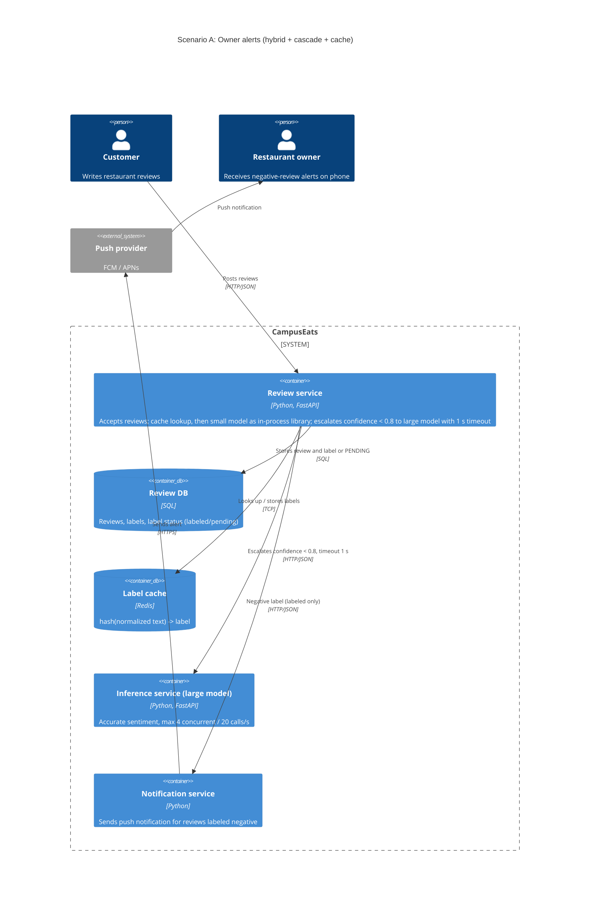

# Task 4: Deployment topologies and trade-offs

**Name / ชื่อ:** บริพัตร อรัญยกานนท์

**Student ID / รหัสนิสิต:** 6631332221

This is **individual work**: each student completes and submits their own copy, in their own fork.

_งานนี้เป็น**งานเดี่ยว** นิสิตแต่ละคนทำและส่งงานของตัวเอง ใน fork ของตัวเอง_

**Scenario (A, B or C) / Scenario ที่เลือก:** A. Owner alerts

Choose **one** scenario below. If the last digit of your student ID is odd, take A or B; if it is even, take B or C. Use your measurements from Tutorial 6 as evidence: cite run names from `results/runs.csv`. Answer in Thai or English.

เลือก scenario **หนึ่ง** ข้อด้านล่าง ถ้าเลขตัวสุดท้ายของรหัสนิสิตเป็นเลขคี่ ให้เลือก A หรือ B ถ้าเป็นเลขคู่ ให้เลือก B หรือ C ใช้ผลการวัดจาก tutorial ที่ทำไปเป็นข้อมูลอ้างอิง โดยอ้างชื่อ run จาก `results/runs.csv` จะตอบเป็นภาษาไทยหรือภาษาอังกฤษก็ได้

Facts that hold in every scenario / ข้อเท็จจริงที่ใช้กับทุก scenario:

- The large model serves at most **20 calls per second** (4 calls at once × about 200 ms each), and every call costs money.

  _large model รับได้สูงสุด **20 calls ต่อวินาที** (พร้อมกัน 4 calls × ประมาณ 200 ms ต่อ call) และทุก call มีค่าใช้จ่าย_

- The small model is fast and cheap enough to run anywhere, including inside the review service or on a kiosk, but it is much less accurate on its own.

  _small model เร็วและถูกพอที่จะรันที่ไหนก็ได้ รวมถึงภายใน review service หรือบน kiosk แต่ถ้าใช้ตัวเดียวจะแม่นน้อยกว่ามาก_

## Scenarios

**A. Owner alerts.** When a customer posts a negative review, the restaurant owner gets a push notification within **2 seconds**. At the lunch peak, CampusEats receives **40 reviews per second**. A missed alert is acceptable, but a wrong alert (for example, "your customer is unhappy" when they are happy) makes owners stop trusting alerts and, in the end, ignore them.

_เมื่อลูกค้าโพสต์รีวิวเชิงลบ เจ้าของร้านจะต้องได้รับ push notification ภายใน **2 วินาที** เวลาช่วงพีคตอนเที่ยง CampusEats ได้รับรีวิวจำนวน **40 รายการต่อวินาที** การพลาด alert ไปบ้างนั้นยอมรับได้ แต่ alert ที่ผิด (เช่น "ลูกค้าไม่พอใจ" ทั้งที่จริงๆ แล้วพอใจ) จะทำให้เจ้าของร้านไม่เชื่อถือและเลิกสนใจ alert ในที่สุด_

**B. Canteen kiosk.** A tablet in each canteen lets students leave a review on the spot. However, the canteen Wi-Fi is poor: the tablets lose their connection several times a day, for minutes at a time. The system must accept every review, even while a tablet is offline. Restaurant owners need the labels **by the end of the day**.

\*มี tablet ในแต่ละโรงอาหารให้นิสิตรีวิวได้ทันที อย่างไรก็ดี การเชื่อมต่อ Wi-Fi ในโรงอาหารไม่ดี ทำให้ tablet หลุดการเชื่อมต่อวันละหลายครั้ง ครั้งละหลายนาที ระบบจะต้องรับรีวิวได้ทุกรายการแม้ขณะที่กำลัง offline อยู่ และเจ้าของร้านต้องการ label **ภายในสิ้นวัน\***

**C. Weekly report.** Restaurant owners want a weekly sentiment report. Nothing in producing this report has to be real-time. **Accuracy matters most** and **cost must be minimal**.

\*เจ้าของร้านต้องการรายงาน sentiment รายสัปดาห์ ไม่มีอะไรที่จะต้องทำแบบ real-time ในการออกรายงานนี้ ความแม่นยำ **(accuracy) สำคัญที่สุด** และ **ค่าใช้จ่ายต้องน้อยที่สุด\***

## Topologies and patterns to choose from / Topology และ pattern ที่เลือกใช้ได้

|     | Topology                        | Where the model runs / โมเดลรันที่ไหน                                                                                                           |
| --- | ------------------------------- | ----------------------------------------------------------------------------------------------------------------------------------------------- |
| T1  | Model as a service, synchronous | Inference service, called for each review (today's baseline) _inference service ถูกเรียกทุกรีวิว (baseline ของวันนี้)_                       |
| T2  | Model as a library              | Inside the review service, or on the device _ภายใน review service หรือบนอุปกรณ์_                                                             |
| T3  | Hybrid                          | Small model locally, large model as a remote service _small model รันในเครื่อง large model เป็น remote service_                              |
| T4  | Asynchronous / batch            | Reviews are queued (broker, W10) or stored, and scored later in bulk _รีวิวถูกเข้าคิว (broker, W10) หรือเก็บไว้ แล้วติด label ทีหลังเป็นชุด_ |

Combine one topology with any of the patterns from Tutorial 6: **fallback**, **cascade** and **cache**.

\*เลือก topology หนึ่งแบบ แล้วผสมกับ pattern จาก Tutorial 6 ได้ตามต้องการ: **fallback**, **cascade** และ **cache\***

## 1. Quality requirements

The three most important quality requirements for your scenario, each with a number where possible.

_quality requirements ที่สำคัญที่สุด 3 ข้อของ scenario ที่เลือก ระบุตัวเลขเมื่อทำได้_

| #   | Quality               | Requirement                                                                                                                                                                                                  |
| --- | --------------------- | ------------------------------------------------------------------------------------------------------------------------------------------------------------------------------------------------------------ |
| 1   | Latency               | เจ้าของร้านได้รับ push notification ของรีวิวเชิงลบภายใน 2 วินาที หลังลูกค้าโพสต์ งบเวลาของการติด label แบ่งเป็น p95 <= 600 ms และกรณีช้าสุด <= 1.2 วินาที (timeout 1 วินาที + เผื่อ overhead 200 ms) เพื่อเหลือเวลาอย่างน้อย 800 ms ให้ส่ง push |
| 2   | Throughput / Capacity | รองรับ **40 รีวิว/วินาที** ช่วงพีคตอนเที่ยง โดยเรียก large model ไม่เกินเพดาน **20 calls/s** มี**เป้า <= 16 calls/s** (<= 40% ของรีวิว) เพื่อเหลือ headroom 20% และ**เพดานที่ยอมรับได้ 20 calls/s** (<= 50%) |
| 3   | Alert correctness     | accuracy ของ label ต้องไม่ต่ำกว่า **93.5%** (เท่ากับ large model ตัวเดียว) และเมื่อระบบไม่แน่ใจหรือ large model ตอบไม่ทัน ให้**ไม่ส่ง alert** (ยอมพลาด alert ดีกว่าส่ง alert ผิด)                            |

## 2. Design / การออกแบบ

Your topology, the patterns you add, and a container-level diagram (C4 level 2). The C4 diagram must be written in Mermaid.

_topology ที่เลือก pattern ที่เพิ่ม และ diagram ระดับ container (C4 level 2) เขียนด้วย Mermaid_

**Topology:** T3 Hybrid: small model รันเป็น library ภายใน review service ส่วน large model เป็น remote inference service

**Patterns ที่ใช้:**

- **Cascade (threshold 0.8):** small model ติด label ทุกรีวิวก่อน ถ้า confidence >= 0.8 ใช้ผลนั้นเลย ถ้าต่ำกว่าจึงส่งต่อไป large model
- **Cache:** ข้อความรีวิวที่ซ้ำกัน (normalize แล้ว hash) ใช้ label เดิม ไม่เรียกโมเดลซ้ำ ซึ่งลดภาระ large model ช่วงพีค
- **Timeout แล้วเป็น `PENDING` แทน fallback:** call ไป large model มี timeout 1 วินาที ถ้าไม่ทันรีวิวนั้นจะเป็น `PENDING` และ**ไม่ส่ง alert** ไม่ fallback ไปใช้ผลของ small model ที่ confidence ต่ำ เพราะ alert ผิดเสียหายมากกว่า alert ที่พลาด
- **ส่วนที่ออกแบบเพิ่ม (ยังไม่ได้วัด):** รีวิวที่เป็น `PENDING` จะถูกติด label ภายหลังเพื่อเก็บสถิติ แต่ไม่ส่ง alert ย้อนหลัง เพราะเลยกรอบ 2 วินาทีไปแล้ว

small model เป็น component ภายใน review service (ระดับ C4 level 3) จึงไม่วาดเป็น container แยก

## 3. Evidence / หลักฐาน

Which runs support your choice? Show the numbers and, for scenario A, the capacity arithmetic: how many large-model calls per second does your design need at the peak?

_run ไหนที่สนับสนุนการตัดสินใจของนิสิต ให้นิสิตแสดงตัวเลขประกอบ และสำหรับ scenario A ให้นิสิตแสดงการคำนวณ capacity ด้วย เพื่อแสดงว่าในช่วงพีคนั้น design ของนิสิตต้องใช้ large model กี่ calls ต่อวินาที_

run ที่ขึ้นต้นด้วย `a-` วัดใหม่สำหรับ scenario นี้ ส่วน run `a-peak40-*` ยิงรีวิวแบบ open loop ที่ **40 รีวิว/วินาทีนาน 30 วินาที (1,200 รีวิว)** เพื่อจำลองช่วงพีคตอนเที่ยง โดยใช้ workload ชุดเดียวกับ `tools/loadtest.py`

| Run                                           | What it shows / แสดงอะไร                                                                                                                                                                                                                                                                                                                                             |
| --------------------------------------------- | -------------------------------------------------------------------------------------------------------------------------------------------------------------------------------------------------------------------------------------------------------------------------------------------------------------------------------------------------------------------- |
| `a-large`, `a-peak40-large`                   | large model ตัวเดียวได้ accuracy 93.5% แต่เรียก large model 100% (`a-large` ซึ่งได้ผลเท่ากับ `t0-large`) เมื่อยิงจริงที่ 40 รีวิว/วินาที ต้องใช้ large model 40 calls/s ซึ่งเป็น**สองเท่าของเพดาน** คิวจึงล้นจนรีวิว 1,167 จาก 1,200 รายการ (97%) timeout กลายเป็น `PENDING` และจากรีวิวเชิงลบจริง 641 รายการ ส่ง alert ได้เพียง 16 รายการ (recall 2.5%) ตัด T1 ทิ้ง |
| `a-small`                                     | small model ตัวเดียวได้ accuracy 72.5% (เท่ากับ `t0-small`) คือติด label ผิดประมาณ 1 ใน 4 รีวิว ทำให้เกิด alert ผิดมาก ขัดกับข้อ 3 ตัด T2 ทิ้ง                                                                                                                                                                                                                       |
| `a-0.8`, `a-peak40-0.8`                       | cascade threshold 0.8 ไม่มี cache ได้ accuracy 93.5% และเรียก large model 64% (`a-0.8` ซึ่งได้ผลเท่ากับ `t2-0.8`) แสดงว่า **0.8 เป็น threshold ต่ำสุดที่ไม่เสีย accuracy** แต่เมื่อยิงจริงที่ 40 รีวิว/วินาที วัดได้ **24.8 calls/s ซึ่งเกินเพดาน** รีวิว 664 จาก 1,200 รายการ (55%) เป็น `PENDING` และ recall ของ alert เหลือ 52.6% จึงใช้ cascade อย่างเดียวไม่พอ  |
| `t2-0.6`, `t2-0.7`                            | ลด threshold แล้ว accuracy ตกเหลือ 91.5% และ 93.0% ไม่ผ่านข้อ 3 ส่วน `t2-0.7` ยังเรียก large model 53% คือ 21.2 calls/s ซึ่งก็เกินเพดานด้วย                                                                                                                                                                                                                          |
| `a-0.8-cache`                                 | cascade threshold 0.8 พร้อม cache ได้ accuracy **93.5%** เรียก large model **40%** (cache hit 34%) และ p95 = **559 ms** ซึ่งยืนยันผลของ `t4-0.8-cache` (93.5%, 40%, p95 573 ms)                                                                                                                                                                                      |
| `a-peak40-0.8-cache`                          | **design ที่เลือก ยิงจริงที่ 40 รีวิว/วินาที:** large model **7.7 calls/s** (230 calls ใน 30 วินาที), pending 0, errors 0, p95 = **258 ms**, ช้าสุด 568 ms และ accuracy 95.7% ส่ง alert เชิงลบ 655 รายการ ผิด 33 รายการ คือ **precision 95.0%** (alert ผิดประมาณ 1 ใน 20) และส่ง alert ได้ 622 จาก 641 รีวิวเชิงลบจริง (recall 97.0%)                                |
| `t1-before` vs `t1-after`                     | **วัดได้:** เมื่อ large model ค้าง 10% ถ้าไม่มี timeout จะได้ errors 20 รายการ (`t1-before`) แต่เมื่อมี timeout รายการที่ค้างจะเป็น `PENDING` คือ errors 0, pending 27 และ p95 = 1,009 ms (`t1-after`)                                                                                                                                                               |
| `a-0.8-cache-hang`, `a-peak40-0.8-cache-hang` | **วัดได้:** design ที่เลือกเมื่อ large model ค้าง 10% ที่ 200 รีวิว ได้ errors 0, pending 10 และ p95 492 ms เมื่อยิงที่ 40 รีวิว/วินาที ได้ errors 0, pending 20 จาก 1,200 (1.7%), p95 262 ms, ช้าสุด 1,014 ms (ถูกตัดด้วย timeout 1 วินาที) และ precision ยังเป็น 95.0% **ข้อเสนอใน design:** รายการ `PENDING` จะไม่ส่ง alert (เป็นการพลาด alert ซึ่งยอมรับได้)     |

**Capacity ช่วงพีค (40 รีวิว/วินาที):**

| Design              | % ไป large model (n=200) | คำนวณที่พีค                  | วัดจริงที่พีค (`a-peak40-*`) | ผ่านเพดาน 20 calls/s? |
| ------------------- | ------------------------ | ---------------------------- | ---------------------------- | --------------------- |
| T1 large ทุกรีวิว   | 100% (`a-large`)         | 40 x 1.00 = 40.0 calls/s     | 40.0 calls/s, pending 97%    | ไม่ผ่าน               |
| cascade 0.8         | 64% (`a-0.8`)            | 40 x 0.64 = 25.6 calls/s     | 24.8 calls/s, pending 55%    | ไม่ผ่าน               |
| cascade 0.8 + cache | 40% (`a-0.8-cache`)      | 40 x 0.40 = **16.0 calls/s** | **7.7 calls/s, pending 0%**  | **ผ่าน**              |

- **ตัวเลขที่ใช้เป็นเป้าคือ 16 calls/s ไม่ใช่ 7.7 calls/s:** run ที่พีคส่ง 1,200 รีวิวแต่ test set มีรีวิวไม่ซ้ำแค่ 500 รายการ ข้อความจึงซ้ำกันมากกว่าปกติ (cache hit 68% เทียบกับ 34% ที่ n=200) ค่า 7.7 calls/s จึงดีเกินจริง ส่วน 16 calls/s ใช้ cache hit 34% ซึ่งใกล้กับข้อมูลจริงมากกว่า
- **ตรวจ concurrency (Little's law):** 16 calls/s x 0.2 s ~ 3.2 calls พร้อมกัน ซึ่งไม่เกิน 4 ที่ large model รับได้
- **สูตรตรวจกับค่าที่วัดได้:** cache ทำงานก่อน cascade ดังนั้นสัดส่วน large calls ~ 0.64 x (1 - cache hit rate) ได้ 0.64 x (1 - 0.34) ~ 0.42 เทียบกับ 40% ที่วัดได้ และ 0.64 x (1 - 0.68) ~ 0.20 เทียบกับ 19% ที่วัดได้ที่พีค ถ้าจะไม่เกิน 20 calls/s ต้องได้ 40 x 0.64 x (1 - h) <= 20 คือ h >= **22%**
- **ข้อจำกัดของหลักฐาน:** load test ที่พีคยาวเพียง 30 วินาทีบนเครื่องเดียว และเวลาที่วัดคือจนถึงตอนที่ review service ตอบกลับ ยังไม่รวมเวลาส่ง push notification

## 4. ADR

Use the ADR format from W5.

_ใช้รูปแบบ ADR จาก W5_

**Title:** ใช้ hybrid (small model ใน review service + large model เป็น remote service) ร่วมกับ cascade threshold 0.8 และ cache สำหรับ owner alerts

**Status:** Proposed

**Context:** เมื่อมีรีวิวเชิงลบ เจ้าของร้านต้องได้รับ push notification ภายใน 2 วินาที ช่วงพีคตอนเที่ยงมีรีวิว 40 รายการ/วินาที แต่ large model รับได้สูงสุด 20 calls/s และทุก call มีค่าใช้จ่าย small model เร็วและถูก แต่ถ้าใช้ตัวเดียวได้ accuracy แค่ 72.5% (`a-small`) การพลาด alert ยอมรับได้ แต่ alert ที่ผิดจะทำให้เจ้าของร้านเลิกเชื่อถือ alert

**Decision:** ใช้ topology **T3 (hybrid)** โดย review service ติด label แต่ละรีวิวตามลำดับดังนี้

1. ตรวจ **cache** ก่อน
2. ถ้าไม่เจอใน cache ให้ **small model** (library ภายใน review service) ติด label
3. ถ้า confidence < 0.8 ให้ **cascade** ต่อไป large model โดยมี timeout 1 วินาที

ถ้า large model ตอบไม่ทัน รีวิวนั้นจะเป็น `PENDING` และไม่ส่ง alert ไม่ fallback ไปใช้ผลของ small model ที่ confidence ต่ำ ส่ง alert เฉพาะรีวิวที่ได้ label เชิงลบจริงเท่านั้น

**Consequences:**

- Positive:
  - accuracy 93.5% เท่ากับใช้ large model ทุกรีวิว โดยเรียก large model เพียง 40% (`a-0.8-cache`)
  - ช่วงพีคคำนวณได้ 16 calls/s ต่ำกว่าเพดาน 20 calls/s และเหลือ headroom 20% เมื่อยิงจริงที่ 40 รีวิว/วินาทีวัดได้ 7.7 calls/s และไม่มีรีวิวค้างเป็น `PENDING` เลย (`a-peak40-0.8-cache`)
  - ที่พีค p95 ของการติด label = 258 ms และช้าสุด 568 ms (`a-peak40-0.8-cache`) แม้ large model ค้าง 10% ก็ช้าสุดเพียง 1,014 ms (`a-peak40-0.8-cache-hang`) ทั้งหมดอยู่ในกรอบ 2 วินาที
  - เมื่อ large model ค้าง ระบบจะพลาด alert (ยอมรับได้) แทนที่จะส่ง alert ผิด (ยอมรับไม่ได้) การรับรีวิวไม่ error (errors 0) และ precision ของ alert ยังเป็น 95.0% (`a-peak40-0.8-cache-hang`)
  - ลดค่าใช้จ่ายของ large model ลง 60% เมื่อเทียบกับ baseline
- Negative:
  - headroom ขึ้นกับ cache hit rate โดยตรง ใน dataset ทดสอบ cache hit อยู่ที่ 34% ถ้าข้อมูลจริงซ้ำน้อยกว่า 22% ช่วงพีคจะเกิน 20 calls/s ทำให้มีคิวรอ large model เกิด timeout และพลาด alert มากขึ้น เพื่อรับมือ review service จะบันทึก cache hit rate และ large calls/s ทุกนาที ถ้า cache hit rate ต่ำกว่า 22% ช่วงเที่ยง ให้แจ้งเตือนและทบทวน ADR นี้ เช่น ปรับ normalization ของ cache key หรือเพิ่ม capacity ของ large model โดยห้ามลด threshold ต่ำกว่า 0.8 เพราะ accuracy จะไม่ผ่านข้อ 3
  - review service ต้องโหลด small model ไว้ในตัว จึงใช้หน่วยความจำมากขึ้น และต้อง deploy ใหม่เมื่อเปลี่ยนเวอร์ชันของ small model
  - precision ของ alert เชิงลบวัดได้ 95.0% (`a-peak40-0.8-cache`) แปลว่ายังมี alert ผิดประมาณ 1 ใน 20 รายการ ถ้าเจ้าของร้านรับไม่ได้ ต้องเพิ่มเงื่อนไขเฉพาะ alert เช่น ส่ง alert เมื่อ confidence ของ label เชิงลบสูงกว่า threshold ที่ใช้ติด label ซึ่งจะแลกกับการพลาด alert มากขึ้น
  - threshold 0.8 ปรับจาก test set ที่มีรีวิวไม่ซ้ำเพียง 500 รายการ และ load test ที่พีคยาวแค่ 30 วินาทีบนเครื่องเดียว ซึ่ง cache hit ที่พีค (68%) สูงกว่าข้อมูลจริงที่น่าจะเป็น

**Alternatives considered:** at least one topology you rejected, and why.

_อย่างน้อยหนึ่ง topology ที่ไม่เลือก และเหตุผล_

> - **T1 (synchronous, large model ทุกรีวิว):** ได้ accuracy 93.5% (`a-large`) แต่ช่วงพีคต้องใช้ 40 calls/s ซึ่งเป็นสองเท่าของเพดาน 20 calls/s เมื่อยิงจริงที่ 40 รีวิว/วินาที รีวิว 97% timeout เป็น `PENDING` และส่ง alert ได้เพียง 16 จาก 641 รีวิวเชิงลบ (`a-peak40-large`) และยังแพงที่สุดด้วย
> - **T2 (small model เป็น library อย่างเดียว):** เร็วที่สุด (p95 28 ms) และไม่มีค่าใช้จ่ายของ large model แต่ accuracy 72.5% (`a-small`) แปลว่าติด label ผิดประมาณ 1 ใน 4 รีวิว ทำให้เกิด alert ผิดมาก ซึ่งเป็นสิ่งที่ scenario นี้ยอมรับไม่ได้
